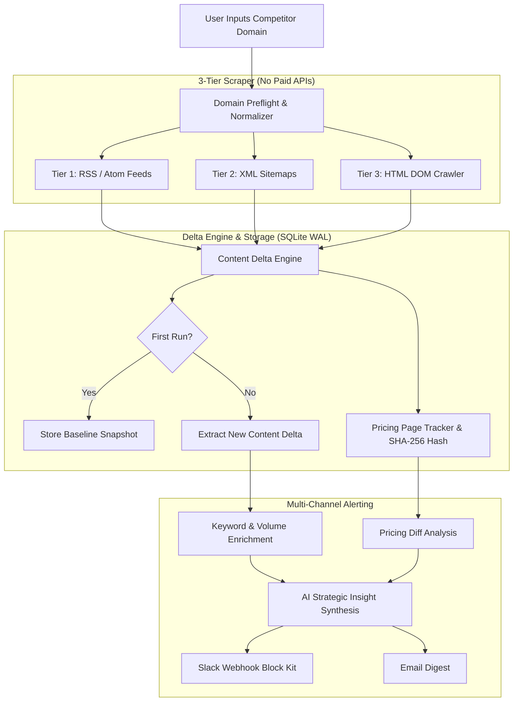

# MarketLens

Competitor Monitoring Alert Tool with a 3-tier crawler, content delta engine, pricing change tracker, and multi-channel alerting (Slack & Email).

---

## Architecture



---

## Quickstart

### Prerequisites
- Python 3.12+
- [`uv`](https://docs.astral.sh/uv/) package manager

### 1. Setup Environment
```bash
cp .env.example .env
```

Configure `.env` as needed:
```env
APP_NAME=MarketLens
PORT=8000
DATABASE_URL=sqlite+aiosqlite:///./marketlens.db

# AI Intelligence (Optional: rule-based fallback if omitted)
GROQ_API_KEY=your_groq_api_key
GROQ_MODEL=openai/gpt-oss-120b

# Notifications
SLACK_WEBHOOK_URL=https://hooks.slack.com/services/YOUR/WEBHOOK/URL
RESEND_API_KEY=your_resend_api_key
NOTIFICATION_EMAIL_TO=alerts@example.com
```

### 2. Run Tests
```bash
uv run pytest
```

### 3. Start Server
```bash
uv run uvicorn app.main:app --host 0.0.0.0 --port 8000 --reload
```

Open dashboard at **`http://localhost:8000`**.

---

## Features

- **3-Tier Custom Crawler:** Discovers feeds, sitemaps, and direct HTML DOM without paid scraping APIs.
- **Zero-Duplicate Delta Engine:** Baseline crawl establishes historical ground truth; subsequent scans only alert on newly published articles.
- **Pricing Monitor:** Fingerprints pricing page DOM to detect plan, currency, or packaging updates.
- **Post Enrichment:** Classifies search intent and estimates organic search volume.
- **Multi-Channel Alerts:** Dispatches Slack Block Kit alerts and formatted email digests with AI strategy insights.
